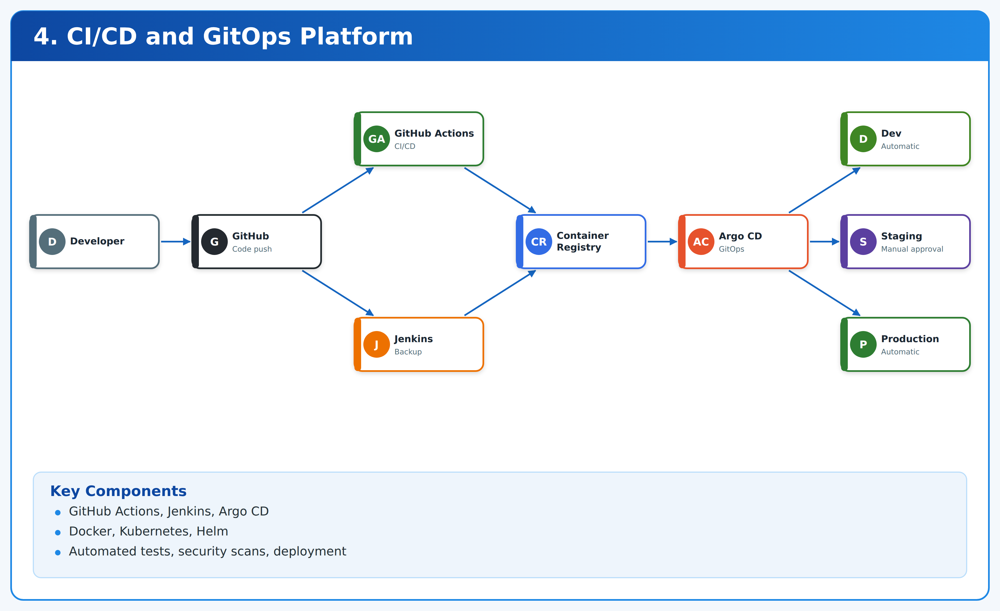
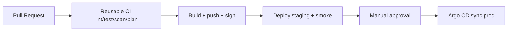

# 04. Reusable CI/CD and GitOps Platform



**GitHub Actions · Jenkins · Argo CD** · *Phase 1 foundations + Phase 2 delivery* · `lab`.

> Reusable Actions + Jenkins shared library + Argo CD ApplicationSets: lint/test/scan, build/sign/push, staging deploy + smoke, manual approval, production sync, rollback.

## Contents

1. Outcomes 2. Architecture 3. Prerequisites 4. Repo map 5. Step 0 clone 6. Step 1 local Docker build 7. Step 2 reusable workflow 8. Step 3 Argo CD GitOps 9. Step 4 Jenkins parity 10. Step 5 promotion + rollback drill 11. Branch protection 12. Teardown 13. Troubleshooting

## 1. Outcomes

- One pipeline definition reused by all 10 portfolio repos.
- Images signed (cosign), SBOM attached, promotion gated on tests + scans + approval.
- Staging auto-sync, prod manual-sync via Argo CD.

## 2. Architecture



## 3. Prerequisites

- git, docker, gh CLI (`brew install gh`), kubectl + kind for Argo lab, argocd CLI optional.
- No cloud needed for Steps 0–2.

## 4. Repository map

```
app/Dockerfile                       # python http lab image
.github/workflows/ci.yml             # hygiene
.github/workflows/reusable-ci.yml   # workflow_call template
.github/workflows/terraform.yml|security.yml
argocd/appset.yaml                   # staging/production ApplicationSet
jenkins/Jenkinsfile                  # parity pipeline
```

## Step 0 — Clone

```bash
git clone https://github.com/navin-kumar10/reusable-cicd-gitops-platform.git
cd reusable-cicd-gitops-platform
bash tests/smoke.sh
cat .github/workflows/reusable-ci.yml
cat argocd/appset.yaml
```

## Step 1 — Build image locally (what CI does)

```bash
docker build -t lab-app:dev ./app
docker run -d -p 8000:8000 --name lab lab-app:dev
curl -s http://localhost:8000/ | head -c 100; echo
docker stop lab && docker rm lab
```

Extend: add `trivy image lab-app:dev --severity HIGH,CRITICAL`, `syft lab-app:dev -o spdx-json=sbom.json`, `cosign sign`.

## Step 2 — Consume the reusable workflow

In any portfolio repo, create `.github/workflows/ci-consume.yml`:

```yaml
name: ci-consume
on: {pull_request: {}, push: {branches: [main]}}
jobs:
  ci:
    uses: navin-kumar10/reusable-cicd-gitops-platform/.github/workflows/reusable-ci.yml@main
```

Test locally with `act` (optional): `act pull_request -j ci`.

Realtime PR: branch → push → Actions tab shows lint/test/scan → required before merge.

## Step 3 — GitOps with Argo CD (kind lab)

```bash
kind create cluster --name gitops || true
kubectl create namespace argocd --dry-run=client -o yaml | kubectl apply -f -
kubectl apply -n argocd -f https://raw.githubusercontent.com/argoproj/argo-cd/stable/manifests/install.yaml
kubectl wait --for=condition=available deploy/argocd-server -n argocd --timeout=300s
kubectl port-forward svc/argocd-server -n argocd 8080:443 &
# admin password:
kubectl -n argocd get secret argocd-initial-admin-secret -o jsonpath="{.data.password}" | base64 -d; echo
kubectl apply -f argocd/appset.yaml
kubectl get applicationset,applications -n argocd
kill %1
```

Sync policy: staging `automated`, production `manual` + `Prune + SelfHeal`. Verify: `argocd app list`, `argocd app sync prod-lab --dry-run`.

## Step 4 — Jenkins parity

```bash
cat jenkins/Jenkinsfile
# stages mirror Actions: Test (make validate) → Scan → Build → Staging → Approval → Prod
# shared library fn: vars/labPipeline.groovy reuse across repos
```

Run only if team needs Jenkins; otherwise Actions is canonical.

## Step 5 — Promotion + rollback drill

1. Merge to main → staging auto-deploys → `curl staging-url` + smoke.
2. Promote: Argo CD UI → prod app → Sync (manual approval recorded).
3. Rollback: `argocd app history prod-lab`, `argocd app rollback prod-lab <prev-id>` or `helm rollback`, then smoke + incident note per `runbooks/ROLLBACK.md`.

## Branch protection (do this on GitHub)

Settings → Branches → require `validate`, `tf`, `scan`, 1 approval, no direct pushes.

## Teardown

```bash
kubectl delete -f argocd/appset.yaml 2>/dev/null || true
kind delete cluster --name gitops
docker rmi lab-app:dev 2>/dev/null || true
```

## Troubleshooting

| Symptom | Cause | Fix |
|---|---|---|
| `reusable workflow not found` | wrong ref/path | pin `@main` or tag, check repo visibility |
| Argo app OutOfSync | drift/manual edit | `argocd app diff`, enable SelfHeal |
| Image pull fail in cluster | registry auth | `kubectl create secret docker-registry`, attach to SA |

Used by all repos. MIT — LICENSE.
